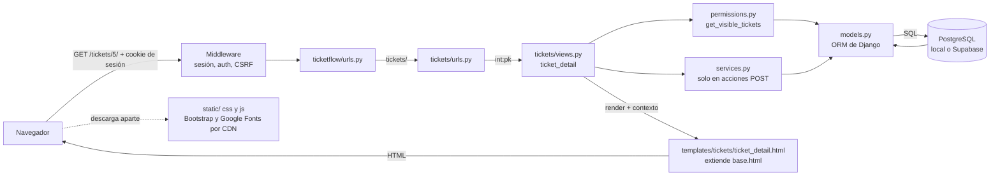
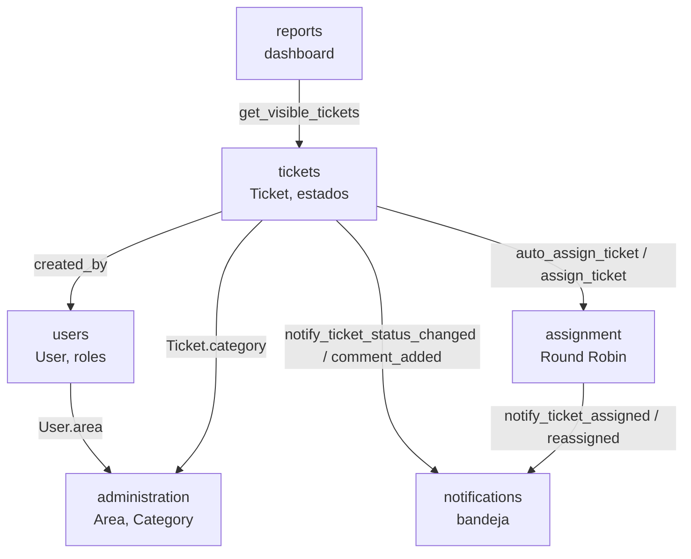

# Guía del código — TicketFlow

Esta guía es un **mapa del repositorio**: qué hay en cada carpeta y
archivo, para qué sirve y con qué se conecta. Está pensada para que
cualquier integrante del equipo pueda explicar el proyecto completo en
la sustentación, aunque no haya programado esa parte.

No repite lo que ya está en
[`documentacion-tecnica.md`](./documentacion-tecnica.md) (arquitectura,
modelo de datos, matriz de permisos, flujos y decisiones técnicas); lo
enlaza cuando hace falta. Todo lo que dice esta guía sale del código del
repositorio. Cuando algo **no se puede confirmar en el código**, se
indica explícitamente.

## Índice

1. [Visión general](#1-visión-general)
2. [Tecnologías usadas](#2-tecnologías-usadas)
3. [Backend, archivo por archivo](#3-backend-archivo-por-archivo)
4. [Frontend, archivo por archivo](#4-frontend-archivo-por-archivo)
5. [Configuración y archivos de soporte](#5-configuración-y-archivos-de-soporte)
6. [Archivos que no hay que tocar](#6-archivos-que-no-hay-que-tocar)
7. [Glosario para la sustentación](#7-glosario-para-la-sustentación)

---

## 1. Visión general

### Qué es TicketFlow

Un sistema web de **tickets internos** para una organización: un
empleado reporta una incidencia o solicitud, el sistema la asigna sola
a un encargado del área que corresponde, el encargado la avanza de
estado (Pendiente → En proceso → Resuelto), las partes reciben
notificaciones dentro de la aplicación y los roles de gestión ven un
dashboard con métricas.

Es **una sola aplicación Django** (monolito modular) dividida en seis
apps: `users`, `tickets`, `assignment`, `notifications`, `reports` y
`administration`. El porqué de esta arquitectura y la responsabilidad
de cada app están en
[documentacion-tecnica.md § 4.1](./documentacion-tecnica.md#41-arquitectura).

### Cómo viaja una petición

Ejemplo real: un encargado de área hace clic en un ticket y el
navegador pide `GET /tickets/5/`.

1. **Navegador → servidor.** El navegador manda la petición junto con
   la cookie de sesión (la que obtuvo al iniciar sesión).
2. **Middleware.** Antes de llegar a ninguna vista, Django pasa la
   petición por los middleware de `settings.MIDDLEWARE`. Entre ellos,
   `SessionMiddleware` y `AuthenticationMiddleware` leen la cookie y
   dejan disponible `request.user`; `CsrfViewMiddleware` protege los
   formularios POST.
3. **`ticketflow/urls.py`.** Es el "índice" de URLs. La ruta
   `tickets/` delega en `tickets/urls.py`.
4. **`tickets/urls.py`.** La ruta `<int:pk>/` llama a la función
   `views.ticket_detail` con `pk=5`.
5. **Vista (`tickets/views.py`).** `ticket_detail` tiene el decorador
   `@login_required` (si no hay sesión, redirige al login). Después
   pregunta a los **permisos**:
   `get_object_or_404(get_visible_tickets(request.user), pk=pk)`. Si el
   ticket no es visible para ese rol, responde 404.
6. **Permisos y servicios.** `tickets/permissions.py` decide qué
   tickets puede ver cada rol; `can_manage_ticket_status` y
   `can_manage_ticket_assignment` deciden qué botones se habilitan; en
   las acciones que modifican datos (POST), la vista llama a un
   **servicio** (`tickets/services.py`, `assignment/services.py`), que
   es donde viven las reglas de negocio.
7. **Modelos y ORM.** Esas funciones usan los modelos (`Ticket`,
   `TicketHistory`…). El ORM de Django traduce las consultas de Python
   a SQL.
8. **PostgreSQL.** La base de datos ejecuta el SQL y devuelve las filas
   (local o en Supabase; para el código es lo mismo).
9. **Plantilla.** La vista llama a `render(...)` con
   `tickets/ticket_detail.html` y un diccionario de datos (el
   "contexto"). La plantilla extiende `templates/base.html`, que agrega
   el menú lateral, la barra superior y las notificaciones (estas
   últimas llegan por el *context processor*
   `notifications/context_processors.py`, en todas las páginas).
10. **Servidor → navegador.** Django devuelve HTML ya armado. El
    navegador lo muestra y descarga aparte el CSS/JS propio
    (`static/`) y Bootstrap y las fuentes desde internet (CDN).

En las acciones que **modifican** datos (cambiar estado, asignar,
comentar) la vista recibe un POST, valida con un formulario, llama al
servicio y responde con una **redirección** al detalle del ticket, en
vez de devolver HTML directamente. Así, recargar la página no repite
la acción.



---

## 2. Tecnologías usadas

Las versiones de Python y Django salen de `requirements.txt` y de
[`instalacion.md`](./instalacion.md). Para cada tecnología se
distingue el **motivo documentado** en el repositorio (en
`CLAUDE.md` o en
[documentacion-tecnica.md § 4.5](./documentacion-tecnica.md#45-decisiones-técnicas-relevantes))
de un **argumento sugerido** para la sustentación cuando el repositorio
no registra la decisión.

Las prioridades del proyecto que se repiten en toda la documentación
son: **tiempo** (13 semanas), **alcance** acotado (proyecto académico,
una organización) y **costo** (todo lo usado es gratuito).

### Dependencias de Python (`requirements.txt`)

Son exactamente tres:

```
Django==5.0.14
psycopg2-binary==2.9.13
python-dotenv==1.2.3
```

### Python

- **Qué es:** el lenguaje de programación en que está escrito todo el
  backend. Versión usada en el desarrollo: 3.12.4 (mínimo razonable
  3.11, según `instalacion.md`).
- **Para qué se usa:** modelos, vistas, reglas de negocio, tests y el
  comando `seed_demo`.
- **Por qué:** viene dado por la elección de Django. El repositorio no
  documenta una comparación con otros lenguajes. *Argumento sugerido:*
  sintaxis legible, gratuito y con un framework web completo
  (Django), lo que reduce tiempo de desarrollo.

### Django 5.0.14

- **Qué es:** un framework web "con baterías incluidas": trae ORM,
  sistema de plantillas, autenticación, sesiones, formularios,
  protección CSRF, panel de administración y un framework de tests.
- **Para qué se usa:** todo el backend. Se usa además mucho de lo que
  ya trae: login/logout y recuperación de contraseña
  (`django.contrib.auth`, vistas nativas en `users/urls.py`), sesiones,
  mensajes (`django.contrib.messages`), paginación (`Paginator`) y el
  Django Admin en `/admin/`.
- **Por qué:** *documentado:* `CLAUDE.md` fija Django y la
  autenticación por sesiones nativas; la documentación técnica explica
  por qué un monolito con Django Templates en vez de SPA + API. El
  repositorio no documenta por qué Django y no Flask u otro framework.
  *Argumento sugerido:* con Flask habría que elegir e integrar por
  separado ORM, login, formularios y admin; Django los trae, lo que
  ahorra tiempo.

### PostgreSQL

- **Qué es:** un motor de base de datos relacional, libre y gratuito.
- **Para qué se usa:** guarda todos los datos. Se configura en
  `settings.DATABASES` con el motor `django.db.backends.postgresql` y
  los valores salen de variables de entorno.
- **Por qué:** *documentado:* `CLAUDE.md` e `instalacion.md` dicen que
  es la única base soportada, **en todos los entornos**, y que **no se
  usa SQLite** ni siquiera para probar rápido. Además, el proyecto usa
  una restricción `CheckConstraint` real en la base
  ([documentacion-tecnica.md § 4.2](./documentacion-tecnica.md#42-modelo-de-datos))
  y `select_for_update()` para bloquear filas en el Round Robin y en
  los cambios de estado. *Argumento sugerido:* SQLite no bloquea filas
  individuales (bloquea la base entera), así que desarrollar con
  SQLite y entregar con PostgreSQL habría escondido diferencias de
  comportamiento.

### Supabase (opcional)

- **Qué es:** un servicio en la nube que ofrece PostgreSQL gestionado
  (no hay que instalar ni mantener el servidor). Tiene plan gratuito.
- **Para qué se usa:** es una **alternativa opcional** a la base
  local. El código no cambia: solo los valores de `.env`, más
  `DB_SSLMODE=require` (Supabase exige conexión cifrada). Pasos en
  [instalacion.md § 13](./instalacion.md#13-usar-supabase-opcional).
- **Por qué:** permite tener la base accesible desde internet sin
  costo. *Documentado:* el plan gratuito pausa el proyecto tras una
  semana sin uso, y los tests se corren contra la base local, no
  contra Supabase.

### psycopg2 (`psycopg2-binary`)

- **Qué es:** el "driver": la librería que permite que Python hable
  con PostgreSQL.
- **Para qué se usa:** Django la usa por debajo cada vez que hace una
  consulta; el código de TicketFlow nunca la importa directamente.
- **Por qué:** *documentado* en `instalacion.md`: se usa la versión
  `-binary` porque no requiere compilar nada al instalarla.

### python-dotenv

- **Qué es:** una librería que lee un archivo `.env` y carga sus
  valores como variables de entorno.
- **Para qué se usa:** `settings.py` llama a
  `load_dotenv(BASE_DIR / ".env")` y después lee todo con
  `os.environ.get(...)`: clave secreta, credenciales de la base,
  configuración de correo.
- **Por qué:** *documentado:* `CLAUDE.md` prohíbe hardcodear
  credenciales en el código. Así las contraseñas quedan en `.env`, que
  está en `.gitignore` y nunca se sube al repositorio.

### Django Templates

- **Qué es:** el sistema de plantillas de Django: HTML con marcas
  especiales (`{{ variable }}`, ``, ``) que el
  servidor completa con datos antes de enviar la página.
- **Para qué se usa:** **toda** la interfaz. No hay frontend separado.
- **Por qué / alternativa descartada:** *documentado* en
  [§ 4.5](./documentacion-tecnica.md#45-decisiones-técnicas-relevantes):
  se descartó **React/SPA**, porque obligaba a construir una API
  completa y a duplicar la autenticación y los permisos en el cliente,
  sin ningún requisito de interactividad que lo justifique. También se
  descartó explícitamente **Django REST Framework (DRF)** en el Bloque
  9: ningún requisito pide un consumidor externo.

### Bootstrap 5.3.3 (por CDN)

- **Qué es:** una librería de CSS y JavaScript con componentes listos
  (grilla responsive, botones, formularios, menús desplegables,
  panel lateral deslizable).
- **Para qué se usa:** la base visual. `templates/base.html` carga
  `bootstrap.min.css` y `bootstrap.bundle.min.js` desde
  `cdn.jsdelivr.net`. El JS de Bootstrap maneja los desplegables
  (notificaciones, cuenta), el menú lateral en móvil (*offcanvas*) y
  las alertas que se pueden cerrar.
- **Por qué / alternativa descartada:** *documentado:* el diseño se
  implementó "sobre Bootstrap 5.3.3, sin Tailwind ni pasos de
  compilación". **Tailwind** habría exigido un paso de compilación
  (Node.js) para generar el CSS. Por CDN no hay nada que instalar ni
  compilar. *Contra:* sin internet la página pierde los estilos (lo
  advierte `instalacion.md`, sección "Problemas comunes").

### Google Fonts: Inter y Material Symbols

- **Qué es:** un servicio gratuito de Google que sirve tipografías.
  Inter es la tipografía del texto; Material Symbols Outlined es una
  fuente de **iconos** (cada icono se escribe con su nombre, por
  ejemplo `inbox`).
- **Para qué se usa:** se cargan en `base.html`. Para no descargar
  miles de iconos, se pide solo un **subconjunto** con el parámetro
  `icon_names=...`, que tiene que estar en orden alfabético. Si una
  plantilla usa un icono nuevo, hay que agregarlo a esa lista.
- **Por qué:** sigue el diseño de referencia
  ([`diseno-referencia.md`](./diseno-referencia.md)), sin costo y sin
  archivos de iconos en el repositorio.

### CSS propio: `static/css/ticketflow.css`

- **Qué es:** la hoja de estilos del proyecto (unas 1.300 líneas).
- **Para qué se usa:** define los colores y medidas del diseño como
  variables CSS (`--tf-*`), que también sobrescriben las de Bootstrap
  (`--bs-*`), y un conjunto de componentes con prefijo `tf-`
  (tarjetas, badges de estado, tablas, filtros, stepper, gráficos del
  dashboard). Detalle en la [sección 4](#staticcssticketflowcss).
- **Por qué / alternativa descartada:** *documentado:* los gráficos
  del dashboard se dibujan con CSS en el servidor y se descartó
  **Chart.js** (que se usó en la primera versión del Bloque 7): era una
  librería extra para dos gráficos simples y los valores quedaban
  dentro de un `<canvas>`, sin texto accesible.

### JavaScript propio: `static/js/ticketflow.js`

- **Qué es:** un archivo de 75 líneas de JavaScript sin librerías.
- **Para qué se usa:** solo **mejoras progresivas**: mostrar/ocultar
  contraseña, confirmar antes de eliminar, vista previa del área al
  elegir una categoría y el atajo de teclado del buscador.
- **Por qué:** *documentado* en `CLAUDE.md`: "JavaScript básico solo
  cuando sea estrictamente necesario". Ninguna regla de negocio vive en
  JavaScript: si se desactiva, el sistema sigue funcionando.

### Herramientas incluidas en Django que conviene nombrar

No son dependencias aparte, pero aparecen en el código:

- **Sistema de tests de Django** (`django.test.TestCase`): los 300
  tests automatizados.
- **Backend de correo de consola:** en desarrollo los correos de
  recuperación de contraseña se imprimen en la terminal en vez de
  enviarse (`EMAIL_BACKEND` en `.env`).
- **Mermaid:** la sintaxis de los diagramas de esta documentación.
  GitHub la dibuja sola; no es parte de la aplicación.

### Lo que el proyecto NO usa

Para responder preguntas del tipo "¿por qué no usaron X?":

| No se usa | Qué se usa en su lugar | Dónde está el motivo |
|---|---|---|
| React / Vue (SPA) | Django Templates | [§ 4.5](./documentacion-tecnica.md#45-decisiones-técnicas-relevantes) |
| Django REST Framework / API | Vistas que devuelven HTML | § 4.5 (Bloque 9) |
| SQLite | PostgreSQL | `CLAUDE.md`, `instalacion.md` |
| Tailwind | Bootstrap + CSS propio | § 4.1 (Capa de presentación) |
| Chart.js | Barras y donut en CSS | § 4.5 |
| JWT / tokens | Sesiones de Django | `CLAUDE.md` |
| Correo por eventos de tickets | Notificaciones internas (`Notification`) | `CLAUDE.md` |
| Colas, cachés, microservicios | Llamadas directas entre apps | § 4.1 |

---

## 3. Backend, archivo por archivo

Todas las apps siguen el mismo patrón (`models` → `permissions` →
`services` → `forms` → `views` → `urls`), explicado en
[§ 4.1 "Separación de responsabilidades"](./documentacion-tecnica.md#41-arquitectura).
Aquí va qué hace cada archivo concreto.

**Archivos que se repiten en todas las apps** y no se explican de
nuevo en cada una:

- **`__init__.py`:** vacío; le dice a Python que la carpeta es un
  paquete.
- **`apps.py`:** declara la app ante Django (clase `UsersConfig`,
  `TicketsConfig`, etc.). Lo genera Django y no tiene lógica.
- **`migrations/`:** ver la [sección 6](#6-archivos-que-no-hay-que-tocar).

### `ticketflow/` — paquete de configuración del proyecto

No es una app de negocio: es el "esqueleto" del proyecto.

- **`settings.py`:** toda la configuración. Ver la
  [sección 5](#ticketflowsettingspy).
- **`urls.py`:** el índice principal de URLs. Conecta `admin/` (Django
  Admin), `accounts/` (`users.urls`), `tickets/`, `notifications/`,
  `dashboard/` (`reports.urls`), `administration/` y la raíz `""`
  (`HomeView`). *Nota:* el comentario de arriba del archivo quedó
  desactualizado: dice que solo están conectadas las piezas básicas,
  pero en el código ya están incluidas todas las apps.
- **`views.py`:** una sola clase, `HomeView` (vista genérica
  `TemplateView`), que muestra `templates/home.html`: la página de
  inicio con accesos por rol o, sin sesión, el botón de login.
- **`wsgi.py` / `asgi.py`:** puntos de entrada para servidores web de
  producción (los genera Django). En desarrollo no se usan:
  `runserver` arranca el servidor por su cuenta. El repositorio no
  incluye ninguna configuración de despliegue a producción.
- **`templatetags/ui.py`:** biblioteca de filtros de plantilla
  ``, registrada en `settings.TEMPLATES`:
  - `ui_field`: agrega las clases de Bootstrap a cada campo de
    formulario y `is-invalid` si tiene errores.
  - `is_checkbox`: indica si un campo es una casilla.
  - `role_label` / `es_label`: traducen al español roles y etiquetas
    usando `users/presentation.py`.
  - `initials`, `display_name`, `age`: iniciales para el avatar,
    nombre para mostrar y antigüedad ("hace 3 horas").
  - `query_replace`: arma la URL actual cambiando un parámetro. Lo usa
    la paginación para conservar los filtros.

  Solo presentación: no consulta la base ni decide permisos.

### `users/` — usuarios, roles y login

- **`models.py`:**
  - `User` extiende `AbstractUser` de Django. Agrega `role` (clase
    interna `Role`: `employee`, `area_manager`, `admin`,
    `management`) y `area` (FK a `administration.Area`).
  - `clean()` exige área para empleados y encargados, y
    `Meta.constraints` lo garantiza también en la base de datos.
  - `TicketFlowUserManager.create_superuser` hace que
    `createsuperuser` cree el usuario con `role="admin"`: sin eso, el
    superusuario nacería como `employee` sin área y la base lo
    rechazaría.
  - Es el `AUTH_USER_MODEL` de `settings.py`.
- **`urls.py`:** no tiene vistas propias. Conecta las **vistas
  nativas de Django** (`LoginView`, `LogoutView`,
  `PasswordResetView` y las tres siguientes del flujo de recuperación)
  con las plantillas de `templates/registration/`.
- **`views.py`:** vacío (el archivo que genera Django). El login y la
  recuperación de contraseña usan las vistas de `django.contrib.auth`.
- **`admin.py`:** `TicketFlowUserAdmin` amplía el `UserAdmin` de Django
  para mostrar y filtrar por `role` y `area` en `/admin/`.
- **`presentation.py`:**
  - `ROLE_LABELS` y `FIELD_LABELS`: textos en español para la
    interfaz.
  - `spanish_role_choices(field)`: traduce las opciones de un select
    de roles.
  - Existe para no cambiar los `choices` del modelo, lo que generaría
    una migración. Lo usan `templatetags/ui.py` y
    `administration/forms.py`.
- **`tests.py` (20 tests):** `UserAreaByRoleTests` (área obligatoria
  según el rol), `UserAreaDatabaseConstraintTests` (la restricción de
  la base) y `PasswordResetTests` (flujo de recuperación de
  contraseña).

### `tickets/` — el ticket y su ciclo de vida

- **`models.py`:**
  - `Ticket`, con su clase `Status` (`PENDING`, `IN_PROCESS`,
    `RESOLVED`).
  - `save()` genera el número `TK-000001` a partir del id la primera
    vez que se guarda.
  - `area` es una `@property` que devuelve `category.area` (no es una
    columna).
  - `clean()` impide asignar el ticket a alguien de otra área.
  - `TicketManager.create_ticket` crea el ticket y su primera entrada
    de historial en una sola transacción.
  - `TicketHistory` (cambios de estado) y `TicketComment`
    (comentarios). Detalle de campos en
    [§ 4.2](./documentacion-tecnica.md#42-modelo-de-datos).
- **`permissions.py`:**
  - `get_visible_tickets(user)` devuelve los tickets que cada rol
    puede ver. Es la función **más reutilizada** del proyecto: la usan
    todas las vistas de tickets, el dashboard y el contador "Mis
    tickets".
  - `can_manage_ticket_status(user, ticket)`: admin, o encargado del
    área del ticket.
- **`services.py`:**
  - `ALLOWED_TRANSITIONS`: el mapa `PENDING → IN_PROCESS → RESOLVED`.
  - `get_next_status(estado)`: el siguiente estado permitido.
  - `change_ticket_status(ticket, new_status, changed_by)`: bloquea la
    fila, valida, guarda el historial y notifica al creador, todo en
    una transacción. Si la transición no es válida, lanza
    `StatusTransitionError`.
  - Se conecta con `notifications/services.py`.
- **`forms.py`:**
  - `TicketCreateForm`: título, descripción y categoría; solo ofrece
    categorías activas.
  - `TicketAssignForm`: solo ofrece encargados activos del área del
    ticket.
  - `TicketCommentForm`.
  - `TicketStatusChangeForm`: solo ofrece el único estado siguiente
    válido, así que un POST manipulado no pasa la validación.
- **`views.py`:**
  - `ticket_create`: solo empleados. Crea el ticket y llama a
    `assignment.services.auto_assign_ticket`.
  - `ticket_list`: filtros `status` (incluido el especial `OPEN`, que
    usa "Mis tickets"), `assignment` y `q`; contadores por estado y
    paginación.
  - `ticket_detail`: arma los pasos del stepper a partir de
    `TicketHistory`.
  - `ticket_assign`: reasignación manual, usa
    `assignment.services.assign_ticket`.
  - `ticket_change_status`: solo POST, usa `change_ticket_status`.
  - `ticket_comment_create`: solo POST. Guarda el comentario y notifica
    en la misma transacción.
- **`urls.py`:** `""` (lista), `new/`, `<pk>/`, `<pk>/assign/`,
  `<pk>/status/` y `<pk>/comment/`. La pantalla de asignación vive
  aquí, aunque la lógica sea de `assignment`.
- **`admin.py`:** registra `Ticket` en `/admin/` con su historial y sus
  comentarios embebidos (*inlines*), y también `TicketHistory`.
- **`tests.py` (106 tests):**
  - modelo y permisos;
  - máquina de estados y sus vistas, y las notificaciones de estado;
  - comentarios y sus notificaciones;
  - paginación y cantidad de consultas (N+1);
  - filtros de la lista ("Mis tickets" incluido) y el stepper;
  - un test de aceptación de punta a punta
    (`TicketLifecycleAcceptanceTests`).

### `assignment/` — quién atiende cada ticket

- **`models.py`:**
  - `AreaAssignmentCursor`: uno por área; recuerda a quién se le
    asignó por última vez, que es el estado del Round Robin.
  - `TicketAssignmentHistory`: registro de cada asignación. Si
    `changed_by` está vacío, la asignación fue automática.
- **`services.py`:**
  - `get_active_area_managers(area)`: los encargados activos del área,
    ordenados por id.
  - `pick_next_area_manager(area)`: el Round Robin. Bloquea el cursor
    con `select_for_update()` y devuelve el siguiente de la lista, o
    `None` si el área no tiene encargados.
  - `assign_ticket(ticket, assigned_to, changed_by)`: asignación
    manual. Valida el área, no toca el cursor, guarda el historial y
    notifica.
  - `auto_assign_ticket(ticket)`: combina las dos anteriores al crear
    un ticket.
  - `AssignmentError`: el error que lanza cuando la asignación no es
    válida.
- **`permissions.py`:** `can_manage_ticket_assignment(user, ticket)`:
  admin, o encargado del área del ticket.
- **`views.py`:** vacío. La pantalla de asignación está en
  `tickets/views.py` (`ticket_assign`), que llama a este servicio.
  Por eso esta app **no tiene `urls.py`**.
- **`admin.py`:** muestra los cursores y el historial de asignaciones
  en `/admin/`.
- **`tests.py` (19 tests):** `RoundRobinTests`,
  `NoResponsibleAvailableTests` (área sin encargados),
  `AreaRestrictionTests`, `ReassignmentTests` y
  `AssignmentNotificationTests`.

### `notifications/` — bandeja de entrada interna

- **`models.py`:**
  - `Notification`, con `NotificationType` (`TICKET_ASSIGNED`,
    `TICKET_REASSIGNED`, `TICKET_STATUS_CHANGED`,
    `TICKET_COMMENT_ADDED`).
  - `mark_as_read()`: marca la notificación como leída y guarda la
    fecha.
- **`services.py`:**
  - `create_notification(...)`: el único punto que crea
    notificaciones.
  - Una función por evento, que decide destinatario y mensaje:
    `notify_ticket_assigned`, `notify_ticket_reassigned`,
    `notify_ticket_status_changed` y `notify_ticket_comment_added`.
  - Las llaman `tickets` y `assignment`; esta app nunca decide
    *cuándo* notificar.
- **`views.py`:**
  - `notification_list`: bandeja con pestañas por tipo y "no leídas",
    y paginación.
  - `notification_mark_read` y `notification_mark_all_read`: solo
    POST.
  - `_redirect_back`: vuelve a la página anterior solo si el destino
    (`next`) es del mismo sitio, así no se puede usar para redirigir a
    sitios externos.
  - Todas las consultas filtran por `recipient=request.user`.
- **`context_processors.py`:** `unread_notifications_count(request)`
  agrega a **todas** las plantillas el número de notificaciones no
  leídas y las 5 más recientes, para el desplegable de la barra
  superior. Está registrado en `settings.TEMPLATES`.
- **`urls.py`:** `""`, `<pk>/read/` y `mark-all-read/`.
- **`admin.py`:** en `/admin/` las notificaciones son de solo lectura
  (`has_add_permission` y `has_change_permission` devuelven `False`).
- **`tests.py` (24 tests):** modelo, bandeja de entrada, contador de no
  leídas, paginación, cantidad de consultas y el centro de
  notificaciones rediseñado.

### `reports/` — dashboard de métricas

- **`permissions.py`:**
  - `DASHBOARD_ROLES`: encargado, admin y gerencia.
  - `can_access_dashboard(user)`: si el rol está en esa lista.
  - `get_dashboard_tickets_queryset(user)`: reutiliza
    `get_visible_tickets` para admin y encargado; a gerencia le da
    todos los tickets.
- **`services.py`:**
  - `parse_date_param(value)`: convierte `AAAA-MM-DD` en fecha y, si
    el formato es inválido, devuelve un mensaje en vez de romper la
    página.
  - `format_average_resolution(duration)`: muestra el promedio en
    horas o en "días + horas".
- **`views.py`:** `dashboard(request)` es la única vista:
  - filtra por área (admin y gerencia) y por fechas;
  - calcula conteos por estado, conteo por área y tiempo promedio de
    resolución (con una subconsulta sobre `TicketHistory`);
  - muestra los últimos 10 tickets, salvo a gerencia.

  Explicación completa en
  [§ 4.3](./documentacion-tecnica.md#43-roles-y-permisos) y
  [§ 4.4](./documentacion-tecnica.md#44-flujos-principales).
- **`urls.py`:** una sola ruta, `""`, montada en `/dashboard/`.
- **`models.py` / `admin.py`:** vacíos. Esta app **no tiene tablas
  propias**: solo lee datos de `tickets`.
- **`tests.py` (48 tests):**
  - permisos, alcance por área, filtros de fecha y estado vacío;
  - conteos por estado, tiempo de resolución y conteo por área;
  - tickets recientes (incluido que gerencia no los vea);
  - cantidad de consultas.

### `administration/` — áreas, categorías y usuarios

- **`models.py`:** `Area` (nombre único) y `Category` (siempre con un
  área; `on_delete=PROTECT`).
- **`permissions.py`:** `can_access_administration(user)`: solo
  `role=admin`.
- **`services.py`:** `is_last_active_admin(user)` dice si ese usuario
  es el único admin activo que queda. Lo usan el formulario de edición
  y la vista de eliminación.
- **`forms.py`:**
  - `AreaForm` y `CategoryForm`.
  - `UserAdminForm`: edición de rol, área y estado; su `clean()`
    bloquea quitarle el rol o desactivar al último admin.
  - `UserCreateForm`: alta con contraseña, basada en el
    `UserCreationForm` de Django.
- **`views.py`:**
  - `_require_admin(request)`: la verificación que usan **todas** las
    vistas del módulo; da 403 si el usuario no es admin.
  - `administration_home`: el panel con contadores.
  - Listar, crear, editar y eliminar áreas (`area_list`,
    `area_create`, `area_edit`, `area_delete`), categorías
    (`category_*`) y usuarios (`user_*`).
  - Los `_delete` capturan `ProtectedError` y lo muestran como mensaje
    en vez de un error 500.
- **`urls.py`:** `""`, más `areas/`, `categories/` y `users/`, cada una
  con `new/`, `<pk>/edit/` y `<pk>/delete/`.
- **`admin.py`:** registra `Area` (con sus categorías embebidas) y
  `Category` en `/admin/`.
- **`management/commands/seed_demo.py`:** el comando
  `python manage.py seed_demo`:
  - crea en una transacción áreas (TI, Mantenimiento, RRHH),
    categorías, 10 usuarios `demo_*` de los cuatro roles y tickets en
    distintos estados, con comentarios;
  - usa los servicios reales (`auto_assign_ticket`,
    `change_ticket_status`);
  - si detecta datos `demo_*` ya cargados, avisa y no hace nada.

  Credenciales en [`demostracion.md`](./demostracion.md).
- **`tests.py` (83 tests):**
  - acceso al módulo;
  - CRUD de áreas, categorías y usuarios;
  - alta de usuarios;
  - regresiones de edición y paginación;
  - protección del último admin y el panel rediseñado.

### Cómo se conectan las apps (resumen)



Las llamadas son imports directos de Python, sin HTTP ni colas (ver
[§ 4.1 "Cómo se comunican entre sí"](./documentacion-tecnica.md#41-arquitectura)).

---

## 4. Frontend, archivo por archivo

Toda la interfaz se arma **en el servidor**. Cada plantilla recibe
sus datos de una vista (el "contexto") y casi todas extienden
`base.html`. Los roles que ven cada pantalla son los que dejan pasar
las vistas; el menú lateral solo muestra los enlaces que ese rol puede
usar, pero la protección real está en el servidor.

### `templates/base.html` — la plantilla madre

- En el `<head>` carga Inter y el subconjunto de Material Symbols
  (Google Fonts), Bootstrap 5.3.3 (CDN) y `static/css/ticketflow.css`.
  Al final carga el JS de Bootstrap y `static/js/ticketflow.js`.
- **Con sesión iniciada** dibuja el "portal": menú lateral
  (`partials/sidebar.html`), barra superior (`partials/topbar.html`) y
  mensajes (`partials/messages.html`).
- **Sin sesión** usa un diseño centrado, para login y recuperación de
  contraseña.
- Define los bloques que llenan las demás plantillas: `title`,
  `content`, `extra_head`, `body_class` y `scripts`.
- Además del contexto de la vista, recibe en todas las páginas
  `unread_notifications_count` y `recent_notifications` (del *context
  processor* de `notifications`).

### `templates/partials/` — piezas reutilizables

| Parcial | Qué muestra | Dónde se usa |
|---|---|---|
| `sidebar.html` | Menú lateral según el rol: Empleado (Mis solicitudes, Crear solicitud), Encargado (Tickets de mi área, Mis tickets, Dashboard del área), Admin (Panel, Todos los tickets, Usuarios, Áreas, Categorías, Dashboard), Gerencia (Dashboard ejecutivo y una nota de que no ve tickets individuales). Más Notificaciones y Cerrar sesión (un formulario POST). | `base.html` |
| `topbar.html` | Barra superior: buscador de tickets (oculto para gerencia; envía `?q=` a `tickets:list`), desplegable con las 5 notificaciones más recientes y menú de cuenta. | `base.html` |
| `messages.html` | Avisos de éxito/error de `django.contrib.messages` (por ejemplo, "Comentario agregado."). | `base.html` |
| `pagination.html` | Botones de página que conservan los filtros activos (con `query_replace`). | Listas de tickets, notificaciones, áreas, categorías y usuarios |
| `status_badge.html` | La "pastilla" de color del estado de un ticket. | Lista, detalle, asignación, dashboard |
| `notification_icon.html` | El icono según el tipo de notificación. | Bandeja y desplegable |
| `form_field.html` | Un campo de formulario completo: etiqueta, campo, ayuda y error. | Formularios de tickets, administración y recuperación de contraseña |
| `form_errors.html` | Errores generales del formulario (los que no son de un campo). | Todos los formularios |
| `admin_header.html` | Encabezado de las pantallas de administración (título, ruta y descripción). | Listas de administración |
| `admin_tabs.html` | Pestañas Panel / Usuarios / Áreas / Categorías. | Pantallas de administración |

### Páginas generales

| Plantilla | Qué muestra | Quién la ve | Vista que la renderiza |
|---|---|---|---|
| `home.html` | Inicio: saludo y tarjetas de acceso según el rol; sin sesión, el botón de login. | Todos | `ticketflow.views.HomeView` |
| `403.html` | "Acceso denegado". Extiende `base.html`. | Quien intenta algo que su rol no permite | La muestra Django sola ante un `PermissionDenied` |
| `404.html` | "Página no encontrada". Extiende `base.html`. | Quien pide algo inexistente o que no puede ver | Django, ante `Http404` / `get_object_or_404` |
| `500.html` | Error interno. Es **autónoma**: no extiende `base.html`, para no depender de nada que pueda estar fallando. | Cualquiera, si hay un error del servidor | Django, ante un error no controlado |

Django usa sus propias páginas de error de depuración cuando
`DEBUG=True`; estas plantillas se ven con `DEBUG=False`.

### `templates/registration/` — login y recuperación de contraseña

Todas reciben los datos de las **vistas nativas de Django** conectadas
en `users/urls.py`. Las ve cualquiera, sin sesión.

| Plantilla | Qué muestra | Vista |
|---|---|---|
| `login.html` | Formulario de inicio de sesión y enlace "¿Olvidaste tu contraseña?". | `LoginView` |
| `password_reset_form.html` | Pide el correo para recuperar la contraseña. | `PasswordResetView` |
| `password_reset_done.html` | "Si existe una cuenta, te enviamos un correo" (nunca dice si la cuenta existe). | `PasswordResetDoneView` |
| `password_reset_email.html` | El **texto del correo** con el enlace (no es una página). | `PasswordResetView` |
| `password_reset_subject.txt` | El **asunto** de ese correo. | `PasswordResetView` |
| `password_reset_confirm.html` | Formulario para elegir la nueva contraseña (se llega desde el enlace del correo). | `PasswordResetConfirmView` |
| `password_reset_complete.html` | Confirmación de que la contraseña cambió. | `PasswordResetCompleteView` |

### `templates/tickets/`

| Plantilla | Qué muestra | Quién la ve | Vista |
|---|---|---|---|
| `ticket_list.html` | La lista con tarjetas de conteo, filtros, tabla y paginación. Cambia según el rol: el empleado ve "Mis solicitudes" y el botón "Nuevo ticket"; el encargado ve "Tickets de mi área" y la tarjeta "Mis tickets"; el admin ve "Todos los tickets", la tarjeta "Pendientes sin asignar" y el filtro de asignación. Gerencia la ve vacía. | Empleado, encargado, admin | `ticket_list` |
| `ticket_form.html` | Formulario para crear un ticket, con vista previa del área de destino (JS). | Empleado | `ticket_create` |
| `ticket_detail.html` | El detalle: stepper del flujo, responsable, botón de avanzar estado o asignar (si el rol puede), historial de estados y asignaciones, y comentarios con su formulario. | Quien puede ver ese ticket | `ticket_detail` |
| `ticket_assign.html` | Formulario de reasignación manual, con el resumen del ticket. | Encargado del área, admin | `ticket_assign` |

### `templates/notifications/notification_list.html`

- **Qué muestra:** la bandeja de notificaciones, con pestañas
  (todas, no leídas, por tipo), botones para marcar como leída y
  paginación.
- **Quién la ve:** todos los roles con sesión.
- **Vista:** `notifications.views.notification_list`.

### `templates/reports/dashboard.html`

- **Qué muestra:**
  - filtros de fecha y, para admin y gerencia, de área;
  - tarjetas de conteo y tiempo promedio de resolución;
  - un donut de estados y barras por área, hechos con CSS;
  - la tabla de tickets recientes.
- **Cambios por rol:** a gerencia le cambia el título ("Resumen
  general"), le muestra una etiqueta "solo agregados" y le oculta la
  tabla de tickets recientes.
- **Quién la ve:** encargado (solo su área), admin y gerencia.
- **Vista:** `reports.views.dashboard`.

### `templates/administration/` — solo admin

| Plantilla | Qué muestra | Vista |
|---|---|---|
| `home.html` | Panel con contadores de usuarios, áreas, categorías y tickets (incluidos los pendientes sin asignar). | `administration_home` |
| `area_list.html` / `area_form.html` | Lista de áreas / formulario de alta y edición. | `area_list` / `area_create`, `area_edit` |
| `category_list.html` / `category_form.html` | Lista de categorías / formulario. | `category_list` / `category_create`, `category_edit` |
| `user_list.html` | Lista de usuarios con rol, área y estado. | `user_list` |
| `user_create.html` | Alta de usuario con contraseña. | `user_create` |
| `user_form.html` | Edición de rol, área y estado de un usuario. | `user_edit` |

Las eliminaciones (`*_delete`) no tienen plantilla propia: son
formularios POST dentro de las listas, con confirmación en JS
(`data-confirm`), y la vista redirige con un mensaje.

### `static/css/ticketflow.css`

Está organizado en 20 secciones numeradas:

1. tokens;
2. base;
3. escala tipográfica;
4. estructura de la aplicación (menú lateral y barra superior);
5. encabezado de página;
6. botones;
7. formularios;
8. tarjetas;
9. badges de estado;
10. tablas;
11. filtros;
12. paginación;
13. alertas;
14. estados vacíos;
15. desplegables;
16. detalle de ticket;
17. barras y donut del dashboard;
18. login;
19. páginas de error;
20. utilidades.

Lo que conviene saber para explicarlo:

- **Tokens:** los colores y medidas del diseño son variables
  (`--tf-*`). Como también redefinen las de Bootstrap, los componentes
  de Bootstrap toman los colores del proyecto sin tocar su código.
- **Responsive:** el menú lateral mide 260 px en pantallas grandes, se
  reduce a una barra de iconos de 72 px en pantallas medianas y en
  móvil se convierte en un panel deslizable. Las tablas, en móvil, se
  muestran como tarjetas apiladas.
- **Gráficos sin librería:** las barras son `div` con un ancho
  calculado en la plantilla; el donut usa `conic-gradient` de CSS.

### `static/js/ticketflow.js`

Cuatro funciones, todas opcionales (si el JS falla, la aplicación
sigue funcionando):

1. **Mostrar/ocultar contraseña:** en los botones con
   `data-toggle-password` (login, recuperación, alta de usuario).
2. **Confirmar antes de eliminar:** en los formularios con
   `data-confirm`. El servidor igual valida y puede rechazar la
   eliminación.
3. **Vista previa del área:** al crear un ticket, muestra a qué área
   irá según la categoría elegida. El área real la calcula siempre el
   servidor.
4. **Atajo de teclado:** `/` o `Ctrl/Cmd + K` pone el cursor en el
   buscador de la barra superior.

Los desplegables, el menú lateral en móvil y las alertas los maneja
el JS de Bootstrap, no este archivo.

---

## 5. Configuración y archivos de soporte

### `ticketflow/settings.py`

La configuración de Django, en orden:

- **`load_dotenv(BASE_DIR / ".env")`:** carga las variables del
  archivo `.env`. `env_bool(...)` convierte textos como `"True"` en
  valores booleanos.
- **Seguridad:** `SECRET_KEY`, `DEBUG` (por defecto `True`) y
  `ALLOWED_HOSTS`, todos desde el entorno.
- **`INSTALLED_APPS`:** las apps de Django (admin, auth, sesiones,
  mensajes, estáticos…) y las seis apps de TicketFlow.
- **`MIDDLEWARE`:** seguridad, sesiones, CSRF, autenticación, mensajes
  y protección contra *clickjacking*.
- **`TEMPLATES`:** carpeta `templates/`, el *context processor* de
  notificaciones y la biblioteca `ui`.
- **`DATABASES`:** PostgreSQL con `DB_NAME`, `DB_USER`, `DB_PASSWORD`,
  `DB_HOST`, `DB_PORT` y, en `OPTIONS`, `sslmode` desde `DB_SSLMODE`
  (por defecto `prefer`; `require` para Supabase).
- **`AUTH_USER_MODEL = "users.User"`** y los validadores de
  contraseña de Django.
- **Idioma y zona horaria:** `LANGUAGE_CODE = "es"`,
  `TIME_ZONE = "UTC"` y `USE_TZ = True`.
- **Archivos estáticos:** `STATIC_URL = "static/"` y
  `STATICFILES_DIRS = [BASE_DIR / "static"]`.
- **Login:** `LOGIN_URL = "users:login"`; después de iniciar o cerrar
  sesión, se vuelve a `home`.
- **Correo:** `EMAIL_BACKEND` y los `EMAIL_*`, desde el entorno.
- **`PAGE_SIZE = 20`:** el tamaño de página compartido por todas las
  listas.

### `.env.example`

La **plantilla** del `.env`, con todas las variables y sin valores
reales: Django (`SECRET_KEY`, `DEBUG`, `ALLOWED_HOSTS`), PostgreSQL
(`DB_*`, incluido `DB_SSLMODE`) y correo (`EMAIL_*`,
`DEFAULT_FROM_EMAIL`). Se copia a `.env` y se completa. El significado
de cada variable está en [instalacion.md § 6](./instalacion.md).

### `.gitignore`

La lista de lo que Git **no** debe subir:

- `.env` y `.env.local` (credenciales);
- `venv/` y otros entornos virtuales;
- `__pycache__/` y `*.pyc`;
- logs, `media/` y `staticfiles/`;
- archivos de cobertura de tests;
- configuración de editores (`.vscode/`, `.idea/`) y archivos del
  sistema operativo;
- la exportación local del diseño de Stitch (`docs/diseño-stitch/`).

### `requirements.txt`

Las tres dependencias con su versión exacta (ver la
[sección 2](#dependencias-de-python-requirementstxt)). Se instalan con
`pip install -r requirements.txt`.

### `manage.py`

El script de línea de comandos de Django (lo genera Django). Por él
pasan todos los comandos: `runserver`, `migrate`, `createsuperuser`,
`test`, `check`, `makemigrations` y el propio `seed_demo`.

### `README.md`

La puerta de entrada del repositorio:

- alcance formal aprobado y funcionalidades adicionales;
- stack, estructura de apps e instalación rápida;
- variables de entorno y uso opcional de Supabase;
- cómo crear el primer admin y cómo correr el servidor y los tests;
- estado del proyecto e índice de la documentación.

### `CLAUDE.md`

Las **reglas del proyecto** escritas para quien siga desarrollándolo
(incluido el asistente de IA usado en el desarrollo):

- stack obligatorio;
- qué no se agrega sin decisión explícita (SPA, colas, otra base de
  datos, otra autenticación);
- prohibición de hardcodear credenciales;
- revisar el estado del repositorio antes de tocar código;
- mantener la documentación al día.

### Carpeta `docs/`

| Documento | Para qué sirve |
|---|---|
| [`documentacion-tecnica.md`](./documentacion-tecnica.md) | Arquitectura, modelo de datos, permisos, flujos y decisiones. |
| [`guia-del-codigo.md`](./guia-del-codigo.md) | Esta guía: mapa archivo por archivo. |
| [`instalacion.md`](./instalacion.md) | Instalación paso a paso, problemas comunes y Supabase opcional. |
| [`manual-usuario.md`](./manual-usuario.md) | Cómo se usa el sistema, por rol. |
| [`casos-de-uso.md`](./casos-de-uso.md) | Alcance formal vs. lo implementado, con la evidencia de cada criterio. |
| [`limitaciones-conocidas.md`](./limitaciones-conocidas.md) | Lo que se decidió no resolver y por qué. |
| [`pruebas-manuales.md`](./pruebas-manuales.md) | Checklist de pruebas de interfaz que los tests no cubren. |
| [`demostracion.md`](./demostracion.md) | Datos de `seed_demo`, guion de demostración y preguntas probables. |
| [`diseno-referencia.md`](./diseno-referencia.md) | Guía del sistema visual (colores, tipografía, componentes) exportada de Google Stitch. |

---

## 6. Archivos que no hay que tocar

### `migrations/` (en cada app)

- **Qué son:** archivos Python que describen, paso a paso, cómo crear
  o modificar las tablas de la base de datos para que coincidan con
  los modelos.
- **De dónde salen:** se generan solos con
  `python manage.py makemigrations` cuando cambia un `models.py`, y se
  aplican a la base con `python manage.py migrate`. Django registra en
  la propia base cuáles ya se aplicaron.
- **Cuántas hay:** 11 en total:
  - `users`: 3;
  - `tickets`: 3;
  - `administration`: 2;
  - `notifications`: 2;
  - `assignment`: 1;
  - `reports`: ninguna, porque no tiene tablas.
- **Regla:** no se editan a mano ni se borran. Si se cambia un modelo,
  se genera una migración nueva. `python manage.py makemigrations
  --check --dry-run` verifica que no falte ninguna.

### `venv/`

El **entorno virtual**: una copia aislada de Python con las
dependencias instaladas. Cada integrante lo crea en su máquina
(`py -m venv venv`). No se sube a Git y no se edita.

### `__pycache__/`

Carpetas que Python crea solo, con versiones compiladas (`.pyc`) de
los archivos, para arrancar más rápido. Se pueden borrar sin problema
(se regeneran) y nunca se suben.

---

## 7. Glosario para la sustentación

- **Modelo:** una clase de Python que representa una tabla de la base
  de datos (por ejemplo, `Ticket`). Cada atributo es una columna.
- **ORM** (*Object-Relational Mapping*): la capa de Django que
  traduce Python a SQL. Se escribe
  `Ticket.objects.filter(status="PENDING")` en vez de un `SELECT`.
- **Queryset:** el resultado de una consulta del ORM. Es "perezoso":
  no toca la base hasta que se usan los datos. `get_visible_tickets`
  devuelve uno.
- **Migración:** archivo generado que aplica los cambios de los
  modelos a la estructura de la base.
- **Vista:** función de Python que recibe una petición y devuelve una
  respuesta (HTML o redirección). Ejemplo: `ticket_detail`.
- **URL / ruta (`urls.py`):** la tabla que dice qué vista atiende cada
  dirección.
- **Plantilla:** archivo HTML con marcas de Django que el servidor
  completa con datos.
- **Contexto:** el diccionario de datos que la vista le pasa a la
  plantilla.
- **Context processor:** función que agrega datos al contexto de
  **todas** las plantillas (en TicketFlow, el contador de
  notificaciones).
- **Formulario (`forms.py`):** clase que valida lo que envía el
  usuario antes de usarlo.
- **Servicio (`services.py`):** función donde vive una regla de
  negocio (por ejemplo, `change_ticket_status`). Las vistas la llaman
  en vez de repetir la regla.
- **Middleware:** código que procesa todas las peticiones antes de
  llegar a la vista (sesiones, autenticación, CSRF).
- **Sesión:** la forma en que el servidor recuerda quién inició
  sesión, mediante una cookie. TicketFlow usa las sesiones nativas de
  Django (no JWT).
- **CSRF:** protección contra formularios falsos enviados desde otro
  sitio. Cada formulario POST lleva ``.
- **Rol:** el tipo de usuario (`employee`, `area_manager`, `admin`,
  `management`), que define qué puede hacer.
- **Permiso (server-side):** la verificación que se hace en el
  servidor, no solo ocultando botones. Un usuario que escribe la URL a
  mano igual recibe 403 o 404.
- **403 / 404:** "prohibido" (puede ver el recurso pero no hacer esa
  acción) y "no encontrado" (TicketFlow lo usa también cuando el
  ticket existe pero no es visible para ese rol, para no revelar que
  existe).
- **Round Robin:** reparto por turnos: cada ticket nuevo de un área va
  al siguiente encargado activo de la lista, y al llegar al final se
  vuelve al primero.
- **Transacción:** un grupo de operaciones en la base que se aplican
  todas juntas o ninguna (`transaction.atomic()`). Si falla la
  notificación, tampoco se guarda el cambio de estado.
- **`select_for_update`:** bloquea filas durante una transacción para
  que dos peticiones simultáneas no las modifiquen a la vez.
- **Máquina de estados:** el conjunto de estados y las transiciones
  permitidas entre ellos (`PENDING → IN_PROCESS → RESOLVED`).
- **Append-only:** registros que solo se agregan, nunca se editan ni
  se borran (historial, comentarios).
- **Clave foránea (FK) y `on_delete`:** una columna que apunta a otra
  tabla y qué pasa si se borra lo apuntado (`PROTECT`, `SET_NULL`,
  `CASCADE`).
- **`CheckConstraint`:** una regla que verifica la propia base de
  datos, no solo Python.
- **Paginación:** mostrar las listas de a 20 elementos (`PAGE_SIZE`).
- **Problema N+1:** hacer una consulta extra por cada fila de una
  lista. Se evita con `select_related`, y los tests lo controlan con
  `assertNumQueries`.
- **CDN:** servidores públicos que entregan archivos comunes
  (Bootstrap, fuentes) para que no estén en el proyecto.
- **Archivos estáticos:** CSS, JS e imágenes propios, en `static/`.
- **Variable de entorno / `.env`:** configuración (contraseñas,
  claves) que vive fuera del código.
- **SSL / `sslmode`:** cifrado de la conexión con la base de datos;
  obligatorio en Supabase.
- **Monolito modular:** una sola aplicación dividida en módulos
  (apps) con responsabilidades separadas.
- **Test de aceptación (end-to-end):** un test que recorre un flujo
  completo como lo haría un usuario real (crear, asignar, avanzar y
  resolver un ticket).
